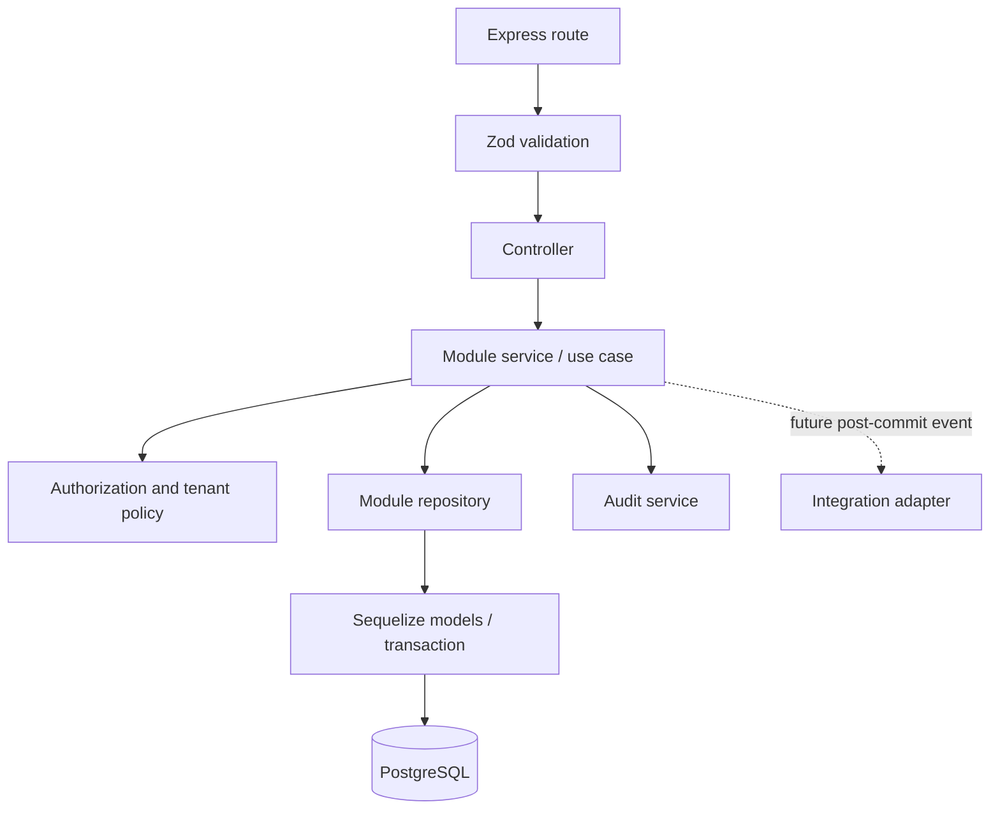

# Backend Modular Architecture

## Runtime

Use Node.js with JavaScript ES Modules, Express, PostgreSQL, Sequelize, and Zod. The first release is one deployable modular monolith. Do not add TypeScript or split modules into network services. `app.js` composes middleware/routes without listening; `server.js` validates configuration, connects dependencies, starts the listener, and handles graceful shutdown.

## Planned layout

```text
backend/
  src/
    config/                 # Zod-validated environment, database and logger setup
    common/
      middleware/           # auth, request ID, validation, rate limit, errors
      errors/               # typed application errors and status mapping
      validation/           # common schemas/primitives
      database/             # Sequelize setup and transaction helpers
      logging/              # Pino setup and redaction
      http/                 # response helpers and API composition
    modules/
      auth/
      users/
      hospitals/
      branches/
      memberships/
      doctors/
      patients/
      schedules/
      appointments/
      audit/
    integrations/           # future provider adapters, only when needed
    app.js
    server.js
  migrations/
  seeders/                   # non-production bootstrap/reference data
  test/                      # location convention chosen at implementation
```

The repository remains a monorepo with planned `patient-app/`, `hospital-app/`, and `docs/` directories. A workspace/build tool is unnecessary until shared packages or coordinated build requirements exist.

## Module structure and ownership

Each implemented module may contain `*.routes.js`, `*.controller.js`, `*.service.js`, `*.repository.js`, `*.model.js`, and `*.schema.js` as the module warrants. Routes bind HTTP paths and middleware; controllers translate HTTP to use cases; services enforce business rules and transactions; repositories own persistence queries; schemas validate external inputs. Keep small modules simple and avoid empty layers.

Modules own writes to their data. Cross-module use goes through an exported service interface or a documented event after commit; one module does not update another module's tables directly. Shared code is for technical primitives, not a catch-all business module.



## Initial module responsibilities

- `auth` and `users`: credentials, sessions, account status, identity profile.
- `hospitals`, `branches`, `memberships`: tenant root, operating locations, staff assignment and role scope.
- `doctors`: professional profile and branch/department affiliation.
- `patients`: patient identity/profile and its hospital registration relationship.
- `schedules`: recurring doctor availability and dated exceptions.
- `appointments`: availability reads, booking lifecycle, cancellation/reschedule and status history.
- `audit`: append-only security and business audit events.

Future bounded modules (encounters, prescriptions, lab, pharmacy, billing, documents, consent, notifications) are not initialized until scoped.

## Persistence and transactions

Sequelize models map the PostgreSQL schema; reviewed migrations, not model auto-sync, define schema changes. Every tenant-scoped repository method requires tenant context. Services own transaction boundaries. Appointment booking and rescheduling must atomically validate schedule/capacity and reserve the time, backed by a PostgreSQL constraint/locking strategy; never rely only on a prior availability read.

Use UUID keys, explicit foreign keys, composite tenant-aware constraints, `timestamptz` for instants, IANA timezone names for schedules, and integer minor units for future money. See [database ERD](database-erd.md).

## Dependency direction

HTTP/common infrastructure may call module interfaces. A module may depend on common primitives and explicitly declared module interfaces, but not reach into another module's repository/model. Integrations are called from services through adapters and are not imported by browser clients. Avoid circular module dependencies; use small shared policies or post-commit events when justified.

## API and operational boundary

Version routes under `/api/v1`. Apply security headers, CORS allowlist, request ID, input validation, authentication, authorization, rate limits for sensitive routes, and centralized error mapping in consistent middleware order. Keep OpenAPI aligned with actual route schemas. Pino redacts secrets and health data; audit records are separate, durable business/security events.

## Environment variable conventions

Use uppercase `SCREAMING_SNAKE_CASE` names, validate all configuration once at startup with Zod, and fail fast on missing or malformed required values. Keep `.env.example` limited to variable names, safe local placeholders, and comments; ignore actual `.env*` files except the example. Never commit keys or production credentials. Suggested initial names include `NODE_ENV`, `PORT`, `LOG_LEVEL`, `API_BASE_PATH`, `DATABASE_URL` (or consistently separated `DB_HOST`, `DB_PORT`, `DB_NAME`, `DB_USER`, `DB_PASSWORD`), `JWT_ISSUER`, `JWT_AUDIENCE`, `JWT_ACCESS_TTL_SECONDS`, `JWT_SIGNING_KEY_ID`, `JWT_SIGNING_PRIVATE_KEY`, `JWT_VERIFYING_PUBLIC_KEYS`, `CORS_ALLOWED_ORIGINS`, and `RATE_LIMIT_*`. Choose either a database URL or discrete DB variables for implementation and document the selected form; never configure both ambiguously. Secrets come from the deployment secret manager in hosted environments. Tests and development use separate credentials and data.
