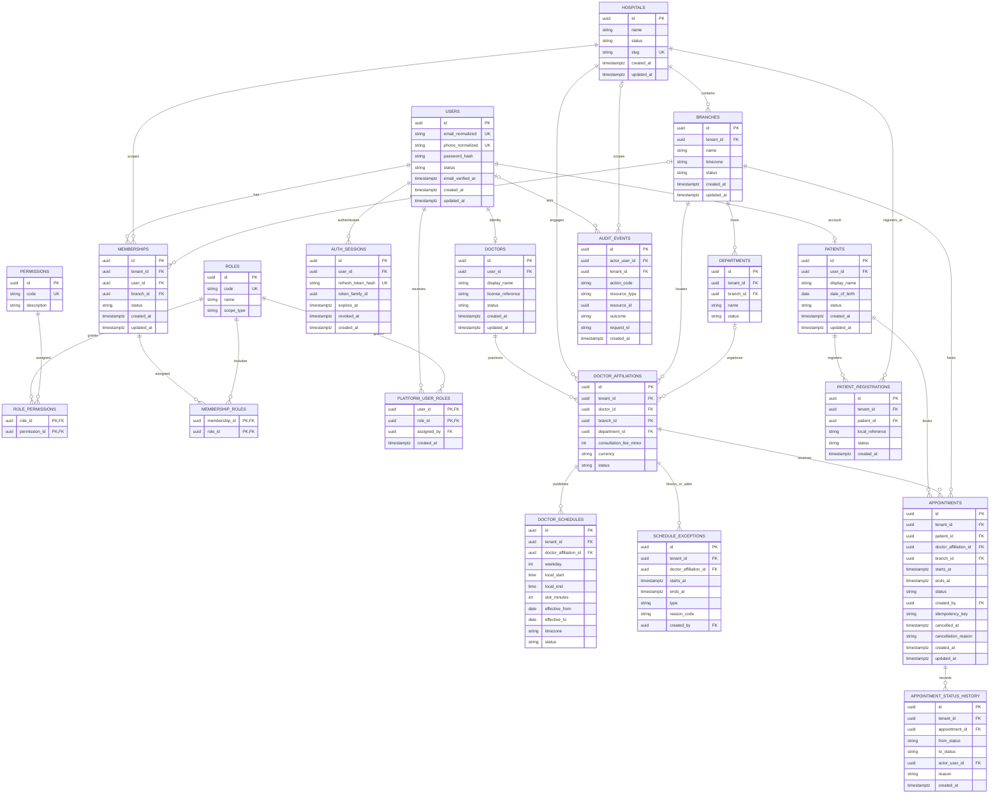

# Initial PostgreSQL Database ERD

This logical ERD covers the explicitly scoped MVP: identity/authentication, hospital tenants and branches, scoped staff roles, doctor/patient profiles, availability, and appointments. It is not a migration specification. All primary keys are UUIDs. Tables use `created_at timestamptz` and `updated_at timestamptz` where mutable; append-only histories use `created_at`. Prefer restrictive foreign keys for retained records. Add `deleted_at` only for safely reversible profile/master data.

## ER diagram

## Keys, relationships, and constraints

- `hospitals.id` **is** the tenant UUID. This resolves the earlier open choice in `docs/database/database-design.md`; do not maintain a duplicate hospital `tenant_id`.
- `users` represent platform identities. A doctor is a professional profile linked to a user and may have affiliations in multiple tenants. A patient identity may also be global; `patient_registrations` represents its relationship to a hospital.
- `memberships` assign a user to a tenant and optionally a branch. `membership_roles` joins scoped membership to role. `SUPER_ADMIN` is assigned through `platform_user_roles` and does not require tenant membership. Role scope types must prevent platform-only roles from being granted through a hospital membership.
- `auth_sessions` stores only refresh-token hashes and rotation family metadata; raw refresh credentials are never persisted. Revoke prior rows on rotation/logout/recovery as policy defines.
- `audit_events` is append-only through application interfaces and captures minimum security/business metadata. Platform events may have a null tenant; tenant-scoped events reference `hospitals.id`.
- Tenant-owned rows include `tenant_id`. Add `UNIQUE (tenant_id, id)` and composite foreign keys such as `(tenant_id, branch_id) REFERENCES branches(tenant_id,id)` wherever parent and child tenant consistency must be guaranteed. The diagram omits these composite details for readability.
- Use `UNIQUE (tenant_id, normalized_name)` for branch/department names where required, `UNIQUE (tenant_id, user_id)` for one active membership per scope, and unique doctor affiliation/branch combinations according to business policy.
- Check constraints: `ends_at > starts_at`, `local_end > local_start` (overnight schedules represented as separate intervals), `slot_minutes > 0`, valid weekday range, positive fee, valid status values, and `effective_to IS NULL OR effective_to >= effective_from`.
- Appointment `status` has a controlled transition policy. Keep status history append-only. Cancellation and rescheduling update the appointment and append history in one transaction; rescheduling may additionally record the prior interval in history/audit.
- Prevent double booking with a PostgreSQL exclusion constraint on overlapping time ranges for the same tenant and doctor affiliation, scoped to reserving statuses (for example `PENDING`, `CONFIRMED`). If required PostgreSQL extensions or hold semantics are not selected, use a transaction-safe slot reservation/locking design with an equivalent database uniqueness guarantee.
- Unique idempotency scope: `(tenant_id, created_by, idempotency_key)` for booking requests. A replay returns the original result; mismatched payload reuse is a conflict.
- All FKs are indexed. Add schedule indexes by `(tenant_id, doctor_affiliation_id, effective_from)` and appointment indexes by `(tenant_id, doctor_affiliation_id, starts_at)` and `(tenant_id, patient_id, starts_at DESC)`.
- Instants use `timestamptz`; recurring schedules retain local wall-clock times plus an IANA timezone. UUID generation should use PostgreSQL-supported UUID generation or application-generated UUIDs consistently.

## Out of scope

Clinical notes, diagnoses, prescriptions, encounters, queue tokens, billing, payments, documents, consents, lab, pharmacy, and inventory are deliberately absent from this initial ERD. Add them only with their workflow and authorization policies in a later phase. This ERD is a design artifact, not a claim of regulatory compliance.
