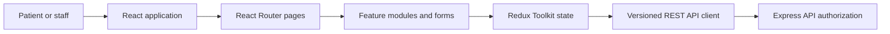

# Frontend Architecture (High Level)

Frontend implementation is out of scope for this phase. The planned clients use JavaScript, React, Vite, Tailwind CSS, React Router, and Redux Toolkit and consume only the versioned backend API.

## Applications

- `patient-app/`: patient registration/login, profile, hospital/doctor discovery, availability, appointment booking and appointment history.
- `hospital-app/`: hospital/branch setup, staff and doctor profiles, availability, and appointment operations.

They may share visual conventions, but should remain distinct application shells because their audiences and authorization flows differ. Do not create a shared frontend package until duplicated code and release needs justify it.

## High-level flow

## Organization principles

When implementation begins, organize UI by features such as `auth`, `hospitals`, `doctors`, `patients`, `availability`, and `appointments`. Keep route pages, reusable components, feature state/selectors, and API calls close to their feature. Centralize API transport, token/session handling, and response parsing. Do not duplicate business rules such as slot availability or permissions in the browser.

Use Redux Toolkit for shared server-derived and session state when needed; keep transient form/view state local. Treat API responses as untrusted, display only fields returned for the actor, and handle `401`, `403`, `404`, and `409` distinctly. Accessible forms and clear validation/error states are required.

## Security boundary

The server is authoritative for authentication, tenant selection, RBAC, resource ownership, and appointment state. The UI can present only memberships returned by the server; a client-supplied hospital ID never proves access. If refresh credentials use cookies, frontend/API deployment must define secure `HttpOnly`, `Secure`, `SameSite`, CSRF, and CORS settings together. No access tokens or health details should be written to browser logs or analytics.
