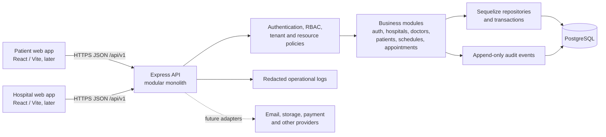

# MediFlow System Architecture

## Goals and boundaries

MediFlow starts as a **modular monolith**: one JavaScript ES Modules codebase, one Express REST API deployment, and one PostgreSQL database. Business capabilities have explicit module boundaries while sharing deployment and transactional storage. Do not introduce microservices, event streaming, Redis, or a frontend implementation during this architecture phase.

The backend is the trusted boundary for identity, input validation, authorization, tenant scoping, and persistence. Browser clients never connect directly to PostgreSQL. Future external providers are reached through backend adapters.

## MVP scope

MVP is limited to authentication; hospital and branch management; doctor and patient profiles; staff role/membership assignment; doctor weekly availability and exceptions; and appointment booking, cancellation, and rescheduling. The first implementation should include the security and operational foundations required by these workflows: validated configuration, migrations, structured logging, audit events, API docs, and tenant-aware authorization.

Explicitly deferred: queue/check-in, consultation and EMR, prescriptions, billing/payments, lab, pharmacy/inventory, document storage/sharing, notifications beyond necessary account/booking communication, AI, and interoperability. Each needs separate workflow and policy definition.

## Logical architecture

## Request flow

1. Express assigns or accepts a trusted request ID, parses the request, and applies security headers and rate limits.
2. Zod validates route parameters, query, and body against an explicit schema.
3. Authentication establishes the actor. Authorization checks role capability, verified tenant membership, resource relationship, branch scope, and allowed state transition.
4. A module service executes the use case. Repositories receive tenant context and use Sequelize transactions where multiple writes or booking contention require atomicity.
5. The API returns the standard success/error envelope and request ID. Logs capture operational metadata; audit events capture sensitive access and security-relevant changes without copying clinical payloads.

## Runtime and deployment shape

Initially run one API process type and PostgreSQL. Keep the Express app factory separate from the `server.js` listener so future API tests can import it. A scheduled worker can be introduced when notification or cleanup needs are defined; it remains part of the same codebase and is not a microservice. Redis, S3, and external provider adapters are future infrastructure decisions.

## Frontend boundary

Plan two React/Vite clients: patient application and hospital staff dashboard. Both call the same `/api/v1` API. The UI may hide unavailable actions for usability, but server-side authorization remains authoritative. See [frontend architecture](frontend-architecture.md).

## Development milestones

1. **Architecture complete:** scope and conventions documented; no application code yet.
2. **Backend foundation and authentication:** JavaScript ES Modules, Express composition, environment validation, Sequelize/PostgreSQL migrations, request IDs, response/error handling, Pino, OpenAPI, authentication, and RBAC.
3. **Organization and profiles:** hospital tenant, branches, departments where needed, scoped staff memberships, doctor profile/branch affiliations, and patient profile.
4. **Availability and appointments:** recurring schedules, exceptions, availability reads, atomic booking, cancellation, rescheduling, status history, and idempotent retries.
5. **MVP clients:** patient booking and hospital management workflows using the API.
6. **Outpatient care:** queue/check-in, encounters, clinical notes, diagnoses, prescriptions.
7. **Expansion:** payments/billing, lab, pharmacy/inventory, consent/documents, richer notifications/reports, and future AI/interoperability after separate discovery.

Milestones 6–7 are roadmap only and are outside the initial MVP.

## Architecture constraints

- PostgreSQL is authoritative. UUID primary keys and migrations are used from the first schema.
- Use transaction-safe constraints for booking; application checks alone cannot prevent double booking.
- Healthcare data is sensitive. Minimize collected/returned fields and redact logs. This design is not a regulatory-compliance claim.
- Keep integrations behind adapters and modules behind stable service interfaces.
- See [multi-tenancy](multi-tenancy.md), [backend architecture](backend-architecture.md), and [database ERD](database-erd.md) for implementation boundaries.

## Decisions still required before implementation or production

- **Before identity implementation:** target login identifier (email, phone, or both), verification requirements, account recovery rules, JWT signing/key-rotation mechanism, and exact refresh-session revocation policy.
- **Before schedule/booking implementation:** appointment duration/slot granularity, treatment of daylight-saving transitions, whether temporary holds exist, booking horizon, allowed cancellation/reschedule windows, and the exact appointment states that reserve capacity.
- **Before tenant operations:** whether staff memberships are hospital-wide or branch-limited by default, patient registration/duplicate matching policy, and the workflow for a patient who uses multiple hospitals.
- **Before production deployment:** launch jurisdiction, hosting/data residency, applicable privacy/security/retention and breach obligations, secret management, backup/restore objectives, and incident response ownership.

Payment collection timing, document upload release controls, clinical workflow policies, and external integrations remain deferred because they are outside this MVP. Resolve them during the phase that introduces those capabilities. These are product/operational decisions; the selected modular-monolith, PostgreSQL, UUID, and shared-table tenant direction is already established.
