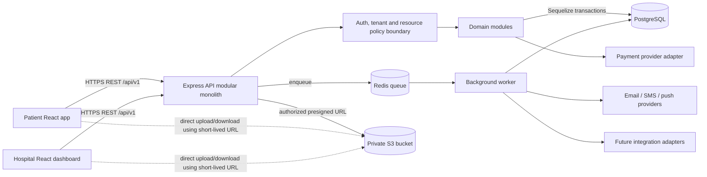
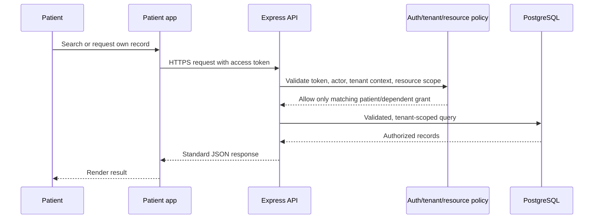
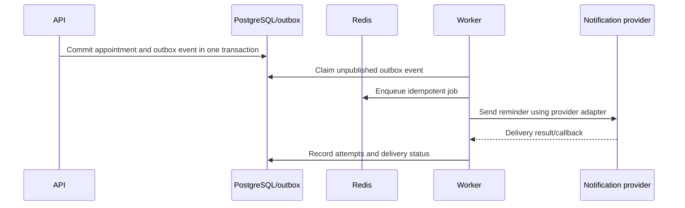

# System Architecture

## Architectural shape

MediFlow starts as a **modular monolith**: one Node.js/Express REST API and one PostgreSQL database, organized by business module. This keeps deployment and transactions simple while preserving boundaries that may support later extraction. The API is the only trusted path to application data. Patient and hospital web clients are separate React/Vite applications (or separately deployed frontends) that call the same versioned API. They do not connect directly to PostgreSQL, Redis, or S3.

## Components and communication

| Component | Responsibility | Communication |
|---|---|---|
| Patient application | Patient and dependent workflows | HTTPS JSON REST calls to API; browser receives short-lived signed file URLs when authorized |
| Hospital dashboard | Staff workflows, scoped to assigned hospital/branch | HTTPS JSON REST calls to API; same server-side policy checks as patient app |
| Backend API | Validation, authentication, authorization, tenant scoping, workflows, persistence, integrations | Express routes → module services → Sequelize/PostgreSQL; enqueue jobs through Redis-backed queue |
| PostgreSQL | Authoritative relational and transactional records | API and job workers through Sequelize; network access restricted to application runtime |
| Redis | Queue transport and, where justified, short-lived cache/rate-limit data | API publishes jobs; worker consumes jobs; never authoritative for clinical records or appointment correctness |
| AWS S3 | Private medical document object storage | Backend issues narrowly scoped presigned upload/download URLs after policy checks |
| Background worker | Reminders, notifications, document/report processing | Consumes queued jobs; reads/writes through shared modules and DB; emits provider requests |
| Notification providers | Email/SMS/push delivery | Worker/API adapter calls provider APIs; provider callbacks are verified before processing |
| External integrations | Payment gateway initially; future labs, FHIR/ABDM, insurance, telemedicine | Isolated adapters; outbound calls from backend/worker, never direct from browser |

The API and worker are separate runtime processes from the same codebase and can be deployed independently, but they are not separate business microservices. Critical state changes remain in PostgreSQL transactions. A durable outbox is recommended when notification/job loss would be harmful: write the business change and outbox event in one transaction, then publish/retry asynchronously.

## High-level architecture



## Patient request flow



## Hospital staff request flow

```mermaid
sequenceDiagram
  participant Staff
  participant UI as Hospital dashboard
  participant API
  participant Policy as Auth/RBAC/tenant/resource policy
  participant DB as PostgreSQL
  Staff->>UI: Open assigned hospital workflow
  UI->>API: HTTPS request with access token and selected organization context
  API->>Policy: Verify identity, active membership, role, branch and patient relationship
  Policy-->>API: Permit only the minimum authorized action
  API->>DB: Transactional tenant-scoped operation
  DB-->>API: Result
  API-->>UI: JSON response; sensitive access recorded
```

## File upload flow

```mermaid
sequenceDiagram
  participant Client
  participant API
  participant DB as PostgreSQL
  participant S3 as Private S3
  Client->>API: Request upload for a patient/document purpose
  API->>API: Authenticate, authorize patient/tenant, validate declared metadata
  API->>DB: Create pending document/version record and opaque object key
  API-->>Client: Short-lived presigned PUT URL and upload constraints
  Client->>S3: Upload directly using URL
  Client->>API: Confirm upload
  API->>S3: Verify object exists/size and expected key
  API->>DB: Mark version available (or quarantined pending scan)
  API-->>Client: Document metadata; no public object URL
```

## Background job flow



## Authentication and authorization boundary

Authentication establishes the user identity. Authorization is enforced on every API operation, never inferred from a hidden UI control. Middleware validates credentials and establishes the actor; module policies then check role/permission, active tenant membership, resource ownership/relationship, branch scope, consent and purpose where relevant. Database access is tenant-scoped by construction. A super-admin path is explicit, highly restricted and audited; it is not a bypass available to ordinary hospital staff.

## Deployment and evolution

Deploy the API, worker, PostgreSQL, Redis, and private S3 bucket as managed services where practical (AWS or Render-compatible hosting). Use HTTPS, secret management, health checks, migrations, backups and environment separation. Avoid Docker in Phase 0: it does not solve a defined requirement for this single modular monolith and adds setup surface. Revisit if reproducible local dependencies or deployment orchestration become a concrete team need.

## MVP boundary

Start with patient identity/profile, hospital/doctor discovery, appointment lifecycle, queue/check-in, basic encounter documentation, prescriptions, document metadata/storage integration design, invoices/payments integration boundary, notifications and audit events. Labs, pharmacy, beds, nursing, advanced reporting and standards integrations are staged as V1/future capabilities (see [product scope](../product/product-scope.md)).
