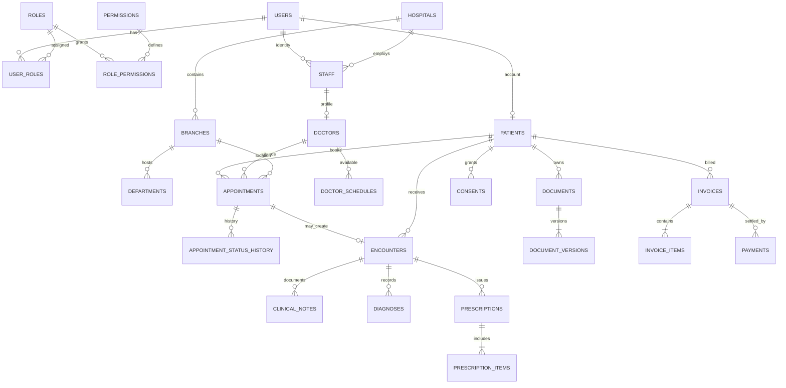

# Database Design (Initial Blueprint)

This is a logical model for Phase 0, not a final migration script. Use PostgreSQL and Sequelize with UUID primary keys, UTC timestamps (`created_at`, `updated_at`), and `deleted_at` only for records that may be safely soft-deleted. Clinical facts, financial transactions, audit events, appointments and status histories should generally be retained and corrected by amendment/reversal rather than soft-deleted. Use explicit status columns with constrained values (PostgreSQL enums or checked strings); favor checked strings if evolving states should not require fragile enum migrations.

## Conventions

- UUID PKs; `tenant_id UUID NOT NULL` for tenant-owned entities. Identity `users` and patient identity may be global; tenant relationships are explicit.
- FKs use restrictive deletion for clinical/financial records. Use `ON DELETE CASCADE` only for disposable dependent data with no retention need.
- Store instants as `timestamptz`; store schedule timezone as IANA name per branch/schedule. Store money as integer minor units plus ISO currency, not floating point.
- Add `created_at`, `updated_at` everywhere; `deleted_at` for reversible master/profile records only.
- Composite uniqueness/FKs include `tenant_id` where they enforce same-tenant parentage.

## Core entities and relationships

### Identity and organization

- `users(id, email, phone, password_hash, status, email_verified_at, created_at, updated_at, deleted_at)`. Unique normalized email/phone according to chosen login policy; passwords never returned.
- `roles(id, code, name, scope_type)` and `permissions(id, code, description)`; unique role/permission codes.
- `user_roles(id, user_id, role_id, tenant_id nullable, branch_id nullable, assigned_by, created_at)`. Scope role assignments; unique applicable assignment.
- `role_permissions(role_id, permission_id)` unique pair. Effective permission remains subject to resource policy.
- `hospitals(id, tenant_id unique, name, status, settings)`; alternatively hospital ID itself may be tenant ID—choose one convention in Phase 1. Recommended simpler convention: `hospitals.id = tenant_id`.
- `branches(id, tenant_id, name, timezone, address, status)`; unique `(tenant_id, normalized_name)` as appropriate.
- `departments(id, tenant_id, branch_id nullable, name, status)`; FK branch with matching tenant.
- `staff(id, tenant_id, user_id, employee_ref, status)`; unique `(tenant_id,user_id)`.
- `doctors(id, tenant_id, staff_id, display/profile fields, license_ref, status)`; separate `doctor_departments` if multiple affiliations are required. A doctor may have profiles in multiple tenants.

### Patients and clinical profile

- `patients(id, user_id nullable, identity fields, status, created_at, updated_at)`: platform-level person profile; minimize sensitive demographics. If patient must be tenant-specific for operational reasons, add a separate `tenant_patients(tenant_id, patient_id, local_ref, status)` relationship.
- `patient_contacts(id, patient_id, type, value, is_primary, verified_at)`.
- `dependents(id, guardian_patient_id, dependent_patient_id, relationship, authority_status, valid_from, valid_to)`; unique active relationship policy and evidence metadata.
- `allergies(id, tenant_id, patient_id, substance, reaction, severity, status, recorded_by, source, recorded_at)`.
- `medical_conditions(id, tenant_id, patient_id, code nullable, display, status, onset_at, recorded_by, source)`.
- `vitals(id, tenant_id, patient_id, encounter_id nullable, type, numeric_value, unit, measured_at, recorded_by)`; preserve units and provenance.

### Scheduling and appointments

- `doctor_schedules(id, tenant_id, doctor_id, branch_id, weekday, local_start, local_end, slot_minutes, effective_from, effective_to, timezone, status)`.
- `schedule_exceptions(id, tenant_id, doctor_id, branch_id, starts_at, ends_at, type [leave/holiday/extra-hours/block], reason_code, created_by)`.
- `appointments(id, tenant_id, patient_id, doctor_id, branch_id, starts_at, ends_at, status, booking_key, reason_category, created_by, cancelled_at, cancellation_reason, created_at, updated_at)`.
- `appointment_status_history(id, tenant_id, appointment_id, from_status, to_status, actor_user_id, reason, created_at)` append-only.
- Prevent overlapping active appointments for a doctor/branch using a PostgreSQL exclusion constraint on a time range where feasible, with status predicate for reserving states. Also enforce idempotency key uniqueness scoped to actor/tenant. Exact slot allocation strategy is detailed in [appointment engine](../architecture/appointment-engine.md).

### Clinical

- `encounters(id, tenant_id, patient_id, appointment_id nullable, doctor_id, branch_id, status, started_at, ended_at, created_at, updated_at)`; one encounter per appointment where policy permits.
- `clinical_notes(id, tenant_id, encounter_id, author_user_id, note_type, body, status, signed_at, amended_from_id nullable, created_at, updated_at)`; amendment history, restricted access.
- `diagnoses(id, tenant_id, encounter_id, code_system nullable, code nullable, display, status, author_user_id, created_at)`.
- `procedures(id, tenant_id, encounter_id, code nullable, display, status, performed_at, author_user_id)`; MVP may defer detailed procedure catalogue.
- `medications(id, tenant_id nullable, catalog_code nullable, name, strength, form, status)`; platform catalogue can be global with tenant formulary mapping later.
- `prescriptions(id, tenant_id, encounter_id, prescriber_id, status, issued_at, valid_until, version, supersedes_id nullable)`.
- `prescription_items(id, tenant_id, prescription_id, medication_id nullable, display_snapshot, dose, route, frequency, duration, quantity, instructions)`.

### Documents, consent and access

- `documents(id, tenant_id nullable, patient_id, encounter_id nullable, category, title, owner_user_id, status, created_at, updated_at)`; tenant association follows the source/owner context; shared patient-level documents still require explicit scope.
- `document_versions(id, document_id, version_number, object_key, mime_type, byte_size, checksum, uploaded_by, status, created_at)`; unique `(document_id, version_number)` and object key.
- `document_shares(id, tenant_id, document_id, grantee_type, grantee_id, purpose, starts_at, expires_at, revoked_at, granted_by)`.
- `consents(id, patient_id, grantee_tenant_id nullable, grantee_user_id nullable, scope, purpose, status, granted_at, expires_at, revoked_at, evidence_ref, created_at)`; version consent changes rather than overwriting.
- `data_access_logs(id, tenant_id nullable, actor_user_id, patient_id, resource_type, resource_id, action, purpose, request_id, created_at)`; append-only and minimize payload.

### Billing and payments

- `services(id, tenant_id, code, name, status)`; unique `(tenant_id, code)`.
- `price_lists(id, tenant_id, branch_id nullable, currency, effective_from, effective_to, status)`; `price_list_items(id, price_list_id, service_id, amount_minor)`.
- `invoices(id, tenant_id, patient_id, appointment_id nullable, encounter_id nullable, status, currency, subtotal_minor, tax_minor, total_minor, issued_at, due_at)`.
- `invoice_items(id, tenant_id, invoice_id, service_id nullable, description_snapshot, quantity, unit_amount_minor, tax_minor, total_minor)`.
- `payments(id, tenant_id, invoice_id, provider, provider_reference, amount_minor, currency, status, idempotency_key, paid_at, created_at)`; unique provider reference and tenant idempotency scope.
- `refunds(id, tenant_id, payment_id, provider_reference, amount_minor, status, reason, created_at)`; immutable financial history.

### Other module placeholders (add when their workflow is in scope)

- Laboratory: `lab_orders`, `lab_order_items`, `specimens`, `lab_results` with order/result status, author, review/release timestamps.
- Pharmacy/inventory: `dispenses`, `inventory_items`, immutable `stock_movements`; derive/reconcile balances rather than silently overwrite.
- Admissions/beds: `admissions`, `beds`, `bed_assignments` with non-overlapping active assignment rule.
- Notifications: `notification_preferences`, `notification_deliveries` with channel, template/version, attempt/status, provider reference; avoid message body containing sensitive details.
- Audit logs: `audit_events` append-only for security/admin/business changes, separate from patient-specific `data_access_logs` if retention/access needs differ.

## Important indexes and constraints

- Index all FKs and `(tenant_id, status)` on operational tables.
- Appointments: `(tenant_id, doctor_id, starts_at)`, `(tenant_id, patient_id, starts_at DESC)`, `(tenant_id, branch_id, starts_at)`; unique idempotency key and no overlapping active doctor appointments.
- Schedules: `(tenant_id, doctor_id, effective_from, effective_to)`; exceptions by doctor/branch and time range.
- Clinical: `(tenant_id, patient_id, created_at DESC)` for encounter/timeline access; restrict through authorization regardless of index.
- Documents: patient/document lookup indexes; unique object keys; access log indexes by patient/time and actor/time.
- Billing: invoice by patient/status/date; unique provider payment references; currency consistent within invoice/payment.
- Use composite `(tenant_id,id)` unique keys where needed as targets for same-tenant composite FKs.

## ER diagram (representative core)

The diagram omits tenant consistency FKs and several future tables for readability. Resolve whether hospitals.id is the tenant UUID and the exact login identity policy before migrations.
